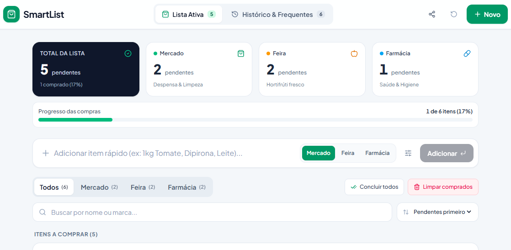
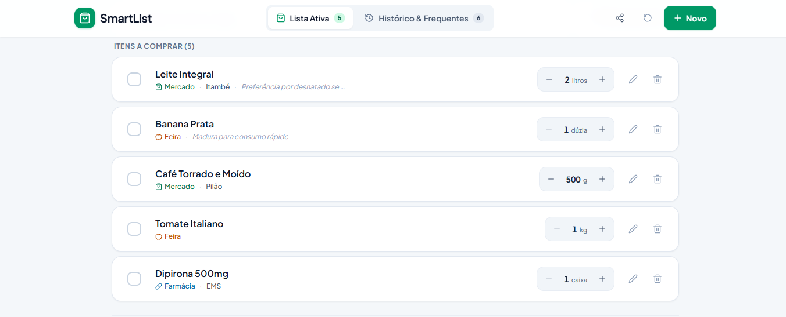
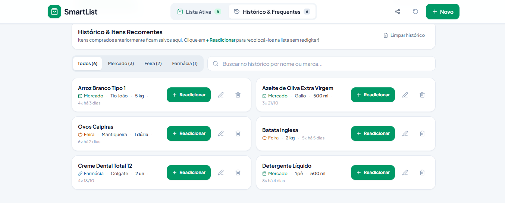

# 🛒 SmartList — Lista de Compras Inteligente

> **Projeto desenvolvido durante a IMERSÃO ENGENHARIA DE SOFTWARE · AULA 1 (Alura + Google)**

O **SmartList** é uma aplicação web focada em simplicidade, velocidade e usabilidade tátil (otimizada tanto para dispositivos móveis quanto para computadores). O objetivo do produto é unificar e organizar o fluxo de compras do dia a dia em três grandes pilares: **Mercado & Despensa**, **Feira & Hortifrúti** e **Farmácia & Cuidados Pessoais**.



---

## 📸 Demonstração da Aplicação

| Tela Principal & Lista | Histórico & Métricas |
| :---: | :---: |
|  |  |

---

## ✨ Funcionalidades Principais

### 1. 📝 Cadastro Completo de Itens

- **Nome do item:** Campo obrigatório com sugestões rápidas contextuais.
- **Marca:** Campo opcional para maior detalhamento da compra.
- **Categorias com cores dedicadas:**
  - 🛒 *Mercado & Despensa*
  - 🥬 *Feira & Hortifrúti*
  - 💊 *Farmácia & Cuidados Pessoais*
- **Unidades de medida flexíveis:** Seletores rápidos (un, kg, g, litros, ml, caixa, pacote, dúzia) e botões de ajuste rápido (`+` / `-`) direto na listagem.
- **Observações:** Espaço para anotações contextuais (ex: *"pegar maduro"*, *"sem açúcar"*).

### 2. ⚡ Gestão Dinâmica da Lista

- **Filtros rápidos:** Alternância ágil entre as abas *Todos*, *Mercado*, *Feira* e *Farmácia*.
- **Busca em tempo real:** Pesquisa por nome ou marca do produto.
- **Ações em lote:** Botão para marcar/desmarcar todos os itens e limpar os já comprados com facilidade.
- **Compartilhamento:** Exportação e formatação da lista organizada por categoria para envio rápido via WhatsApp.

### 3. 🔄 Histórico de Compras & Recompra em 1 Clique

- **Armazenamento de frequentes:** Itens comprados ou removidos vão para a aba *Histórico & Frequentes*.
- **Métricas de uso:** Registro da quantidade de vezes que o item foi comprado e data da última compra.
- **Botão `+ Readicionar`:** Recoloca o item instantaneamente na lista ativa preservando marca, quantidade e unidade sem necessidade de redigitar nada.

### 4. 📊 Métricas e Persistência

- **Persistência de Dados:** Todos os itens e histórico continuam gravados mesmo após fechar ou atualizar a página (`localStorage`).
- **Resumo e Progresso:** Cartões no topo exibindo contagem de itens pendentes por categoria e barra percentual do progresso das compras.

### 5. ⭐ Favoritos — Evolução Posterior do Projeto

A funcionalidade de **Favoritos** foi incorporada posteriormente à versão inicial do SmartList, em uma nova etapa de desenvolvimento realizada com o apoio do **Google Antigravity**.

Essa evolução amplia a experiência de uso ao permitir que produtos favoritos sejam identificados e acessados com mais facilidade, contribuindo para a praticidade na organização das compras recorrentes.

**Demonstração da funcionalidade:**


---

## 🛠️ Tecnologias Utilizadas

- **HTML5 / CSS3** (Interface responsiva com foco em usabilidade mobile)
- **TypeScript** (Lógica de componentes e tipagem de dados)
- **LocalStorage API** (Armazenamento de dados no próprio navegador)

---

## 🚀 Como Executar o Projeto

1. Clone este repositório para o seu computador:

   ```bash
   git clone https://github.com/R-archang3lo/smartlist-app.git
   ```

2. Acesse a pasta do projeto:

   ```bash
   cd smartlist-app
   ```

3. Instale as dependências:

   ```bash
   npm install
   ```

4. Inicie o servidor de desenvolvimento:

   ```bash
   npm run dev
   ```

5. Acesse o endereço local disponibilizado pelo Vite no terminal.

---

## 🤖 Evolução e Desenvolvimento com IA

O SmartList nasceu como projeto prático durante a **Imersão Engenharia de Software da Alura em parceria com o Google** e continuou evoluindo após as atividades iniciais.

A implementação posterior da funcionalidade de Favoritos contou com o apoio do **Google Antigravity**, explorando novas possibilidades de desenvolvimento e evolução de produtos digitais com ferramentas de Inteligência Artificial.

---

**Desenvolvido por Raphaela Archangelo**
